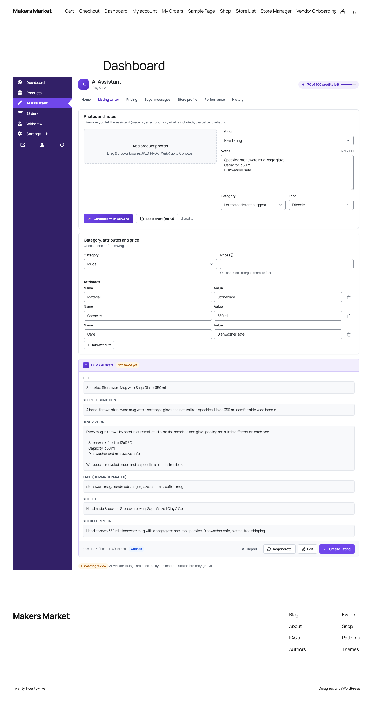

# DEV3 AI Vendor Assistant for Dokan & WCFM

An AI assistant inside the Dokan and WCFM vendor dashboards: listing writer, price suggestions, buyer reply drafts, store bio/SEO and performance tips, with admin quotas and moderation.



## Features

Give every vendor on your marketplace an assistant inside their own dashboard, styled to match Dokan or WCFM:

* **Listing writer** – photos + a few notes become a title, descriptions, tags, attributes, category, SEO text and alt text. Creates the product for the vendor.
* **Price suggestions** – compares with similar published listings on the marketplace (public prices and ratings only) and suggests a price and range.
* **Buyer replies** – one inbox for product reviews, order notes, WCFM inquiries and Dokan Pro support topics, with reply drafts that are sent back to the right place.
* **Store bio & SEO** – bio, tagline, SEO title/description and keywords saved into the marketplace's own fields.
* **Performance tips** – sales, listing quality, stock and reviews from the vendor's own data, summed up as clear next steps.

For the marketplace owner:

* Turn features on or off for everyone or per vendor, and switch the assistant off for a vendor.
* **Monthly AI credits per vendor** with a full ledger (credits, tokens, estimated cost, CSV export).
* **Moderation** of AI-written listings: hold for review or flag, blocked words, approve/reject with a note, DEV3 AI policy check.
* Vendors only ever see their own data (strict ownership checks on every request).
* Everything works without AI too: basic helpers for every feature.

Uses Google AI with your own API key, a monthly budget cap, caching and PII masking. No licence key required.

## Requirements

- WordPress 6.0 or newer (tested up to 6.8)
- PHP 7.4 or newer
- WooCommerce with Dokan or WCFM (required)
- Optional: your own Google AI API key (from Google AI Studio) to switch on the DEV3 AI features. The rest of the plugin works without one.

## Installation

### From the release zip

1. Download `dev3-ai-vendor-assistant.zip` from the [latest release](https://github.com/dev3tech/dev3-ai-vendor-assistant/releases/latest).
2. In WordPress, go to **Plugins → Add New → Upload Plugin**, choose the zip and click **Install Now**.
3. Click **Activate**.

### Build from source

```bash
git clone https://github.com/dev3tech/dev3-ai-vendor-assistant.git
cd dev3-ai-vendor-assistant
composer install --no-dev
npm ci
npm run build
```

Then copy the `dev3-ai-vendor-assistant` folder into `wp-content/plugins/` and activate it.

### Getting started

1. Install WooCommerce and Dokan (Lite or Pro) or WCFM Frontend Manager + WCFM Marketplace.
2. Upload and activate the plugin.
3. Open DEV3 AI Vendors → API Config and add a Google AI key (optional).
4. Vendors find "AI Assistant" in their dashboard menu. Full documentation: Documentation/index.html in the download.

## FAQ

### Does it work without an API key?
Yes. Every feature has a basic (non-AI) helper.

### Can vendors see other vendors' data?
No. Only public listing data (title, price, rating, store) is used for price comparisons.

### Does it support Dokan Pro and WCFM Ultimate?
Yes, through their documented hooks: vendor staff, Dokan Pro biography/store SEO and store support topics.

## Privacy

Product notes, photos, listing text, store facts and buyer messages (first names only) are sent to Google AI when a vendor uses an AI feature. Nothing is sent when AI is off. The plugin adds a privacy-policy snippet and supports WordPress personal-data export and erase.

## Documentation

The full HTML guide (installation, settings, hooks and FAQ) is in [`docs/index.html`](docs/index.html). Open it in a browser after cloning or downloading the repository.

## Changelog

### 1.0.0
* Initial release.

## Licence

Released under the GNU General Public License v2.0 or later (GPL-2.0-or-later). See [LICENSE](LICENSE).

## More from DEV3

- [DEV3 AI Vendor Assistant for Dokan & WCFM on the DEV3 Marketplace](https://www.dev3.tech/item/dev3-ai-vendor-assistant)
- [More WordPress plugins, themes and templates from DEV3](https://www.dev3.tech/marketplace)
